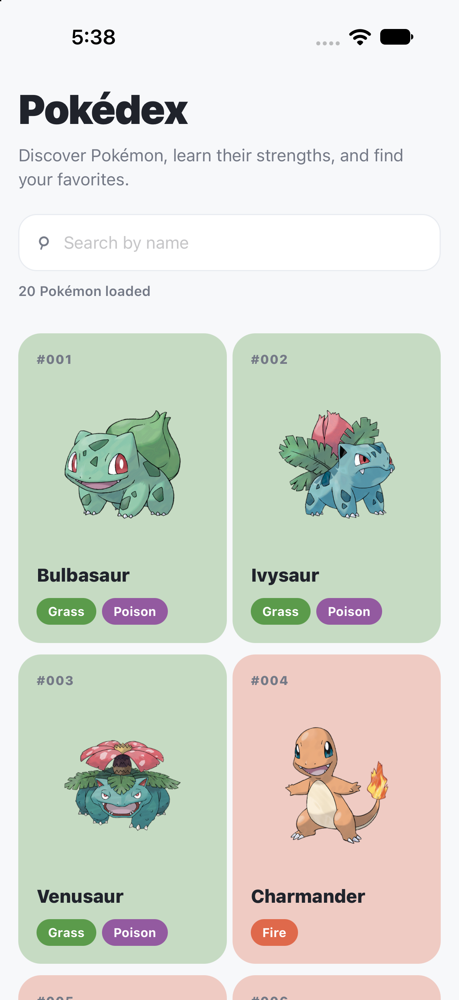
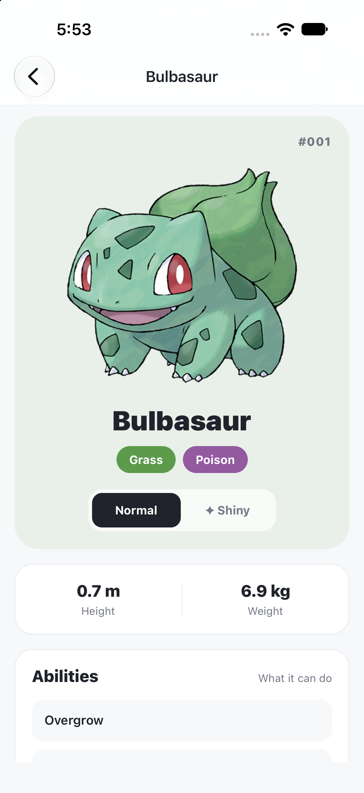
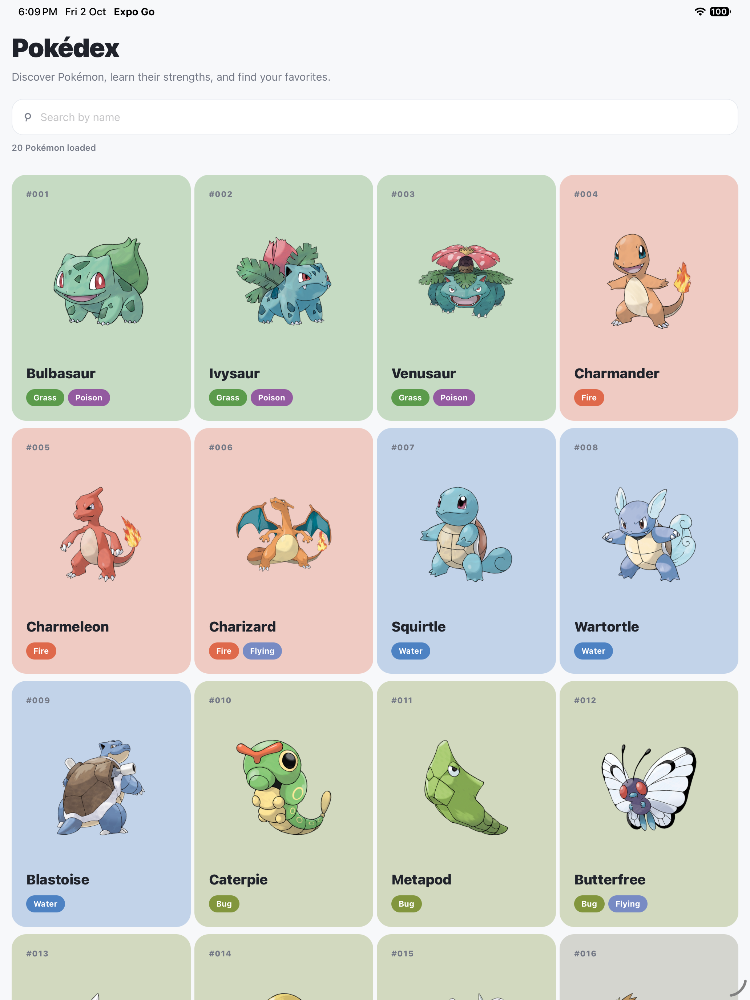
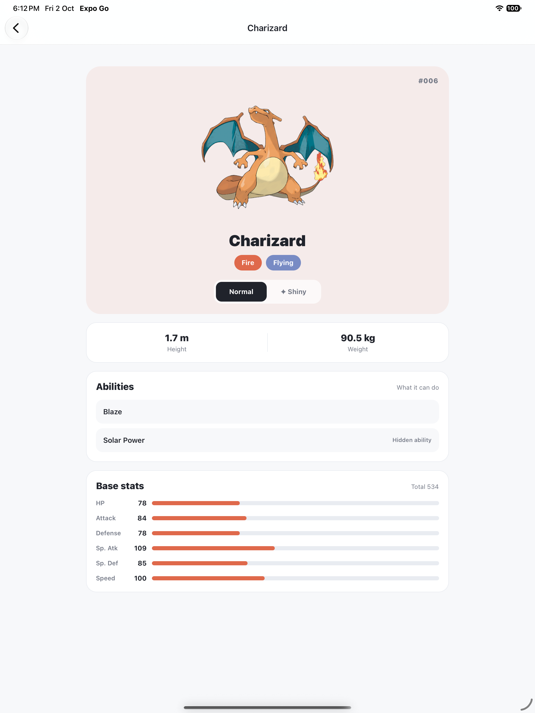

# Pokédex

A responsive Expo and React Native Pokédex for browsing Pokémon, searching the full catalog, and exploring each Pokémon’s artwork and stats.

## Screenshots

### iPhone 18 Pro

The home screen uses a two-column card grid on iPhone. Each card shows the Pokémon’s number, artwork, name, and types.



### Pokémon details

The detail screen shows Bulbasaur’s artwork, type, shiny toggle, measurements, and abilities. Scroll to see its base stats.



### iPad Pro 13-inch

The tablet layout shows four Pokémon cards per row, making it easy to scan more of the Pokédex at once.



### Pokémon details on iPad Pro 13-inch

The detail page keeps its content centered on the larger iPad screen, with the artwork, measurements, abilities, and base stats visible in one scrollable view.



## Features

- Search across the full Pokédex, including Pokémon that have not loaded in the list yet.
- Load more Pokémon automatically as you scroll.
- Use a responsive card grid: two columns on phones and four columns on iPad.
- Open a detail page with type, height, weight, abilities, and base stats.
- Switch between normal and shiny artwork with an animated transition.

## Run locally

Install dependencies and start Expo:

```sh
npm install
npx expo start
```

Open the project in Expo Go or an iOS simulator from the Expo CLI menu.
